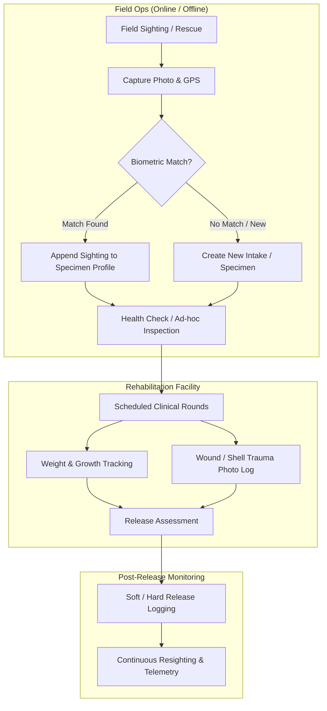
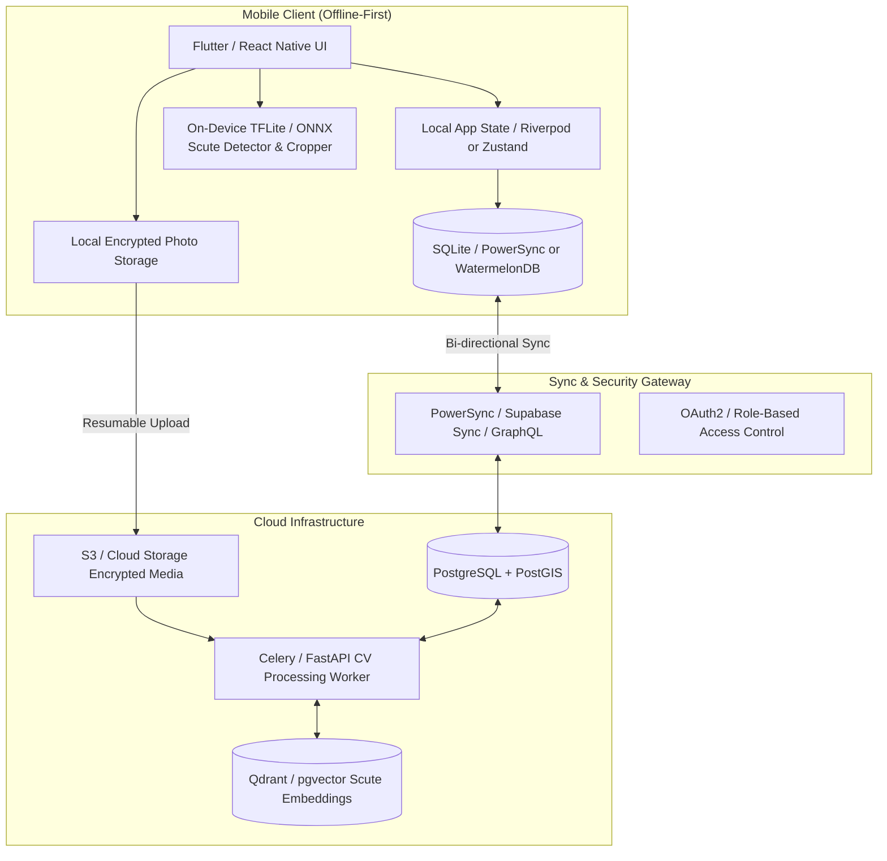
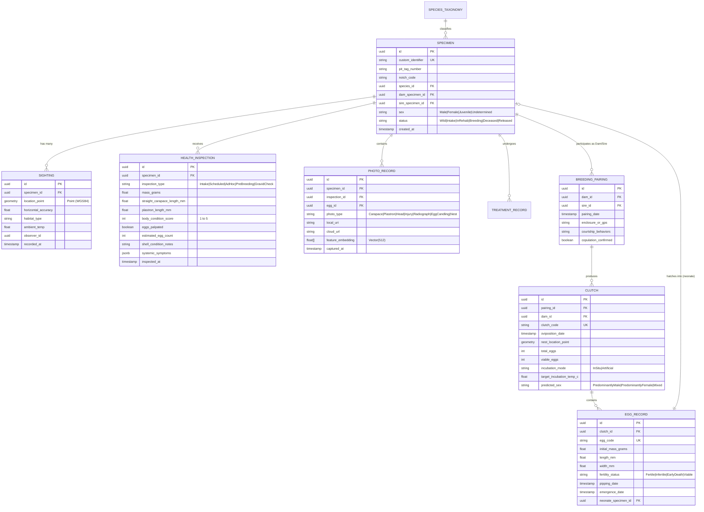

# SATRA (Tortoise Management System)
## Mobile Application Specification: Rescue, Rehabilitation, Tracking & Biometric Monitoring

---

## 1. Executive Summary & Vision

**SATRA** is a purpose-built, offline-first mobile application engineered for wildlife rangers, herpetologists, rescue centers, veterinarians, and citizen-science field observers. Its mission is to modernize tortoise conservation by replacing legacy spreadsheets and basic forms (such as AppSheet) with a ruggedized field application featuring biometric shell-pattern recognition, GPS tracking, clinical rehabilitation tracking, and automated sync.

### Key Objectives
1. **Accurate Identification**: Configurable custom ID schemas (marginal scute notch codes, PIT tags, alphanumeric serials) combined with scientific taxonomy (family, genus, species, subspecies).
2. **Biometric Shell Recognition**: Computer vision scute-topology recognition allowing field workers and citizens to identify individuals by photographing carapace/plastron patterns.
3. **Spatio-Temporal Tracking**: Real-time and historical GPS mapping of rescue coordinates, sightings, GPS tag telemetry, and post-release dispersal patterns with anti-poaching coordinate masking.
4. **Clinical Health & Rehabilitation**: Structured protocols for intake triage, Body Condition Scoring (BCS), straight carapace length (SCL) / mass tracking, shell trauma progression, and treatment schedules.
5. **Rugged Field Usability & Offline-First**: Zero-latency local storage, sunlight-readable high-contrast UI, glove-friendly targets, and seamless multi-master cloud synchronization.

---

## 2. Competitive & Industry Benchmarking

| System | Strengths | Limitations for Tortoise Conservation | SATRA Advantage |
| :--- | :--- | :--- | :--- |
| **Wildbook (Wild Me)** | World-class CV pattern matching for sea turtles/zebras | Web-centric, poor offline field experience | Native on-device mobile capture, offline cache, edge-assisted feature extraction |
| **SMART Conservation** | Proven anti-poaching and patrol tracking | Generic incident focus; lacks longitudinal clinical rehab workflows | Dedicated individual reptile medical records, SCL/mass growth curves |
| **CyberTracker** | Iconic non-literate, fast icon-based field logging | Rigid UI, dated visual architecture, complex form authoring | Modern Flutter/React Native UX, rich media albums, dynamic form engine |
| **iNaturalist** | Excellent community species classification | No individual identity tracking, no clinical rehab/medical history | Individual specimen lifecycle management (Intake $\rightarrow$ Rehab $\rightarrow$ Release $\rightarrow$ Monitoring) |
| **Legacy AppSheet** | Rapid prototyping | High network dependence, sync collisions, limited offline photo caching, no computer vision | Native offline-first database, on-device image preprocessing, edge biometric matching |

---

## 3. Core Functional Requirements

### 3.1 Taxonomy & Configurable Specimen Identification
1. **Scientific Taxonomy Database**:
   - Integrated offline database of Testudinidae (e.g., *Stigmochelys pardalis*, *Chersina angulata*, *Psammobates geometricus*, *Homopus spp.*, *Centrochelys sulcata*, etc.).
   - Pre-populated fields: Order, Suborder, Family, Genus, Species, Subspecies, Common Names (multilingual / vernacular), IUCN Red List status (CR, EN, VU, NT, LC).
2. **Configurable Unique Identifier Generator**:
   - Custom pattern authoring via template tokens (e.g., `{SPECIES_PREFIX}-{YEAR}-{LOCATION_CODE}-{AUTO_SEQ:4}`).
   - **Marginal Scute Notch Coding**: Interactive graphical scute selector (standard Cagle 1939 notch system or custom organizational scheme: Marginal scutes 1–12 left/right).
   - **Microchip (PIT Tag)**: 15-digit FDX-B RFID transponder input with Bluetooth RFID wand/scanner integration.
   - **Tattoo / Epoxy Tag / Carapace Paint Code**: Secondary physical marks.

### 3.2 Biometric Shell Pattern Recognition (AI/CV)
1. **Standardized Capture Guide**:
   - In-app camera viewfinder overlay with silhouette bounding boxes for:
     - **Dorsal (Carapace)**: Center scutes, vertebral and pleural scute junctions.
     - **Ventral (Plastron)**: Gular, humeral, pectoral, abdominal, femoral, and anal scutes.
     - **Anterior / Head**: Facial scale patterns.
   - Gyroscope & angle sensor validation to ensure photos are taken perpendicular ($90^\circ \pm 10^\circ$) to avoid perspective distortion.
2. **Matching Engine**:
   - **Edge Tier (On-Device)**: Lightweight model (MobileNet / YOLOv8-segmentation) to crop, isolate, and extract scute junction keypoints (Scale-Invariant Feature Transform / SuperPoint).
   - **Server Tier (Cloud / Workstation)**: Deep metric learning / triplet-loss embeddings comparing topological scute graphs against the central catalog.
   - **Candidate Review UI**: Presents top-5 potential matches with side-by-side split screen and heat-map alignment overlay for researcher confirmation.

### 3.3 Geospatial Tracking & Field Sighting
1. **Location Metadata**:
   - High-precision GPS (Latitude, Longitude, Altitude, Horizontal Accuracy in meters, Fix Type, Satellites Count).
   - Micro-habitat categorization (fynbos, renosterveld, succulent karoo, bushveld, agricultural border, roadside, urban garden).
   - Weather & environmental metrics (ambient temperature, ground surface temperature, cloud cover, rainfall in past 24h).
2. **Anti-Poaching Protection (Fuzzy Geofencing)**:
   - For endangered species (e.g., Geometric Tortoise *P. geometricus*), GPS data must be strictly encrypted at rest and in transit.
   - Public / Citizen role: Coordinates are automatically obscured / snapped to a 10km grid buffer. Full coordinates are restricted to verified conservation managers.
3. **Telemetry & Tracking Hardware Integration**:
   - VHF radio-transmitter frequency logging.
   - GPS / LoRaWAN / Satellite logger tag attachment tracking (Tag ID, battery level, detach date).

### 3.4 Clinical Rehabilitation & Health Inspections
1. **Inspection Types**:
   - **Intake / Rescue Triage**: Immediate threat assessment (dog attack, vehicle strike, lawnmower injury, veld fire burn, trade confiscation).
   - **Ad-Hoc Field Health Check**: Quick roadside / field evaluation.
   - **Scheduled Clinical Rounds**: Daily/weekly/monthly rehab monitoring (custom recurring schedule).
2. **Biometric Measurements & Morphometrics**:
   - **Mass ($g / kg$)**: With integrated Bluetooth scale pairing.
   - **Carapace Length**: Straight Carapace Length (SCL max and SCL min), Curved Carapace Length (CCL).
   - **Plastron Length (PL)** and **Shell Height (SH)**.
   - **Condition Indices**: Automatic calculation of Jackson’s Ratio or Donoghue Body Condition Index ($Mass / SCL^3$) to alert for dehydration or wasting.
3. **Systemic Health Evaluation**:
   - **Eyes**: Clear, discharge, swollen, sunken.
   - **Nares / Respiratory**: Clear, bubble/discharge (Runny Nose Syndrome - RNS), wheezing.
   - **Oral Cavity**: Pink, pale, yellow plaques (stomatitis/herpesvirus).
   - **Shell Integrity**: Pyramiding grade (0-3), shell rot, scute peeling, fissures, fractures.
   - **Parasite Load**: Tick count (scute margins, inguinal/axillary pockets).
4. **Treatment & Medication Tracker**:
   - Antibiotics, analgesics, fluid therapy, deworming, calcium/vitamin supplementation.
   - Push notifications & calendar reminders for next scheduled dose or inspection.

### 3.5 Specimen Photo Album & Visual Progression
1. **Categorized Media Management**:
   - Photos automatically tagged by type: *Dorsal, Ventral, Head, Left Flank, Right Flank, Injury, Radiograph/X-Ray, Release*.
2. **Side-by-Side Healing Progression Slider**:
   - Compare shell fracture stabilization or burn healing across time-stamped inspection photos.
3. **Offline Image Optimization**:
   - Progressive local thumbnail generation.
   - Multi-resolution pipeline: WebP thumbnail (150px) for instant scroll, balanced display image (1200px), and background RAW/high-res sync when connected to Wi-Fi.

### 3.6 Reproductive & Breeding Management (Conservation Studbook)
1. **Mating & Courtship Logging**:
   - Pairing records: Female (Dam) ID, Male (Sire) ID, cohabitation enclosure/field GPS.
   - Courtship behaviors observed: mounting, head bobbing, ramming/circling, vocalization, successful copulation.
2. **Gravidity & Pre-Nesting Monitoring**:
   - Inguinal fossa palpation logs (calcified egg detection, estimated clutch size).
   - Radiography (X-Ray) and Ultrasound media linkage with egg count and calcification scoring.
   - Pre-oviposition behavioral flags: pacing, exploratory digging, appetite changes.
3. **Nesting & Oviposition Event Recording**:
   - Exact nest location (GPS point with anti-poaching security).
   - Nest micro-environment: soil type, depth (cm), chamber diameter, vegetation shade percentage, soil moisture, ground temperature.
   - In-situ vs. ex-situ decision: nest protected in place (cage/predator barrier) or collected for artificial incubation.
4. **Clutch & Individual Egg Management**:
   - Clutch ID auto-generation linked to Dam and Sire.
   - Clutch metrics: total eggs, viable eggs, damaged/broken, infertile/undeveloped.
   - Individual egg tracking:
     - Egg code (e.g., `CLUTCH-042-E01`), weight ($0.1g$ precision), length and width ($0.1mm$ precision).
     - Orientation marking flag (ensuring egg is not inverted after embryonic chalking).
5. **Incubation & Temperature-Dependent Sex Determination (TSD)**:
   - Target sex ratio management:
     - Tortoises exhibit Pattern Ia TSD (temperatures below pivotal ~$30^\circ\text{C}$ yield predominantly males; temperatures above ~$31.5^\circ\text{C}$ yield females; species-specific customizable pivotal thresholds).
   - Incubator environment logging: temperature, relative humidity, substrate (vermiculite/perlite:water ratio by weight).
   - **Candling Timeline**: Regular embryonic development milestones (chalking band expansion, blood vessel spidering, eye spot, movement, late-term absorption, embryo mortality).
6. **Hatching, Emergence & Neonate Lineage Enrollment**:
   - Pipping date, emergence date, incubation duration in days.
   - Neonate health assessment: emergence mass ($g$), initial SCL ($mm$), yolk sac status (absorbed / unabsorbed / rupture risk), egg tooth presence, scute anomalies.
   - Automatic generation of juvenile specimen record, inheriting taxonomic data and establishing studbook pedigree (Sire, Dam, F-generation level).
   - Juvenile survival cohorts: 30-day, 90-day, and 1-year monitoring protocols.

---

## 4. Technical Architecture

### 4.1 Recommended Tech Stack
- **Mobile Framework**: **Flutter (Dart)**.
  - *Rationale*: Uniform 60fps high-performance UI across Android and iOS, native camera streams with sensor/gyroscope overlays, mature offline database integration (Drift/SQLite), and direct on-device TensorFlow Lite / ONNX acceleration.
- **Local Embedded Database**: **SQLite** (via Drift) with **PowerSync** or custom sync queue.
  - Local-first architecture: All CRUD operations occur against local SQLite. Zero UI wait-spinners.
- **Sync Protocol**:
  - Incremental delta synchronization with Conflict-Free Replicated Data Types (CRDTs) or Last-Write-Wins with revision vectors.
- **Backend**:
  - **FastAPI (Python)** or **Go** with **PostgreSQL** + **PostGIS** for high-performance spatial queries (heatmaps, spatial clustering, dispersal polygons).
- **Computer Vision Pipeline**:
  - Edge: **TensorFlow Lite** or **ONNX Runtime** for real-time bounding box extraction, angle validation, and scute segmentation.
  - Cloud: **ResNet50 / ViT backbone** fine-tuned on chelonian scute topologies, indexed in **pgvector** or **Qdrant** for nearest-neighbor similarity search.

---

## 5. Offline-First Synchronization Strategy

1. **Queued Mutation Pipeline**:
   - Every action (New Sighting, Intake, Health Metric, Photo Attachment) writes to an immutable local `OutboxQueue` table with a UUIDv7 timestamp.
2. **Background Sync Worker**:
   - Triggers automatically when network connectivity transitions to `WIFI` or `CELLULAR`.
   - Supports resumable chunked uploads for media (tus.io protocol) to handle intermittent rural cell coverage without restarts.
3. **Conflict Resolution Rules**:
   - *Specimen Core Metadata*: Admin/Ranger authority over citizen observations.
   - *Health Inspections*: Append-only logs (no conflicts; sequential by timestamp).
   - *Location Tracks*: Time-series append-only GPS records.

---

## 6. Field Usability & Ruggedized UX Guidelines

1. **High-Contrast Sunlight Mode**:
   - Pure black-and-white high-contrast visual theme with anti-glare typography (minimum 16pt body, bold labels).
2. **One-Handed & Glove-Friendly Interaction**:
   - Critical interaction targets minimum 48x48dp (recommended 64dp in field mode).
   - Bottom-sheet controls within thumb reach; no vital actions in top corners.
3. **Physical Button Trigger**:
   - Option to map hardware volume rocker to shutter release for photo capture with wet/dirty gloves.
4. **Quick Intake Widget**:
   - Rapid 3-tap rescue capture: *[Take Photo] $\rightarrow$ [Auto-Grab GPS] $\rightarrow$ [Flag Critical / Routine]*. Clinical details can be filled in later back at the clinic.

---

## 7. Data Model Entity-Relationship Diagram (Draft)

---

## 8. Implementation Roadmap & Phased Rollout

### Phase 1: MVP Core (Weeks 1–6)
- Setup Flutter offline-first architecture with SQLite & Supabase / FastAPI backend.
- Species taxonomy catalog + custom identifier generator.
- Intake form, health check logger with weight & SCL tracking, photo capture.
- Basic map view with offline tile caching.

### Phase 2: Biometric Scute CV & Advanced Health (Weeks 7–12)
- In-app guided photo capture with alignment reticle.
- Edge scute-detector model integration for automated cropping.
- Server-side feature matching engine & candidate ranking UI.
- Scheduled treatment reminders & Jackson's ratio calculator.

### Phase 3: Field Testing, Anti-Poaching & Hardening (Weeks 13–16)
- Pilot deployment with partner tortoise sanctuaries/reserves in South Africa / arid zones.
- GPS obfuscation rules for endangered taxa.
- Bluetooth scale and RFID microchip wand scanner integration.
- Final sync performance tuning over edge 2G/3G connections.
